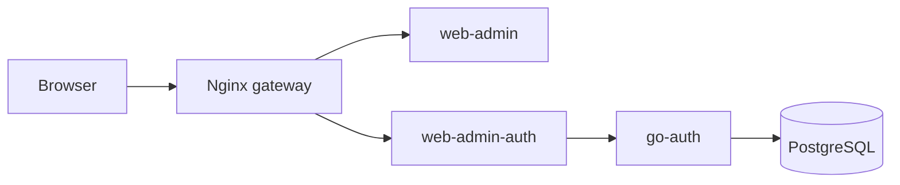

# Infrastructure

Runtime stack for an SMB technology product. Prioritize a sound technical core:
secure routing, correct configuration, persistent data, readiness, and recovery.
Deploy working backend contracts before product features. The admin UI is an
operating console for that core.



Provider callbacks also reach `go-auth` through the gateway. Redis is present
in Compose; the auth runtime can run with Redis disabled.

## Current layout

- `clusters/prod/gateway`: Nginx, upstreams, virtual hosts, static errors.
- `clusters/prod/go-auth`: auth, PostgreSQL 16, Redis 7, persistent volumes.
- `clusters/prod/web-admin`: frontend and stateless cookie adapter.
- `clusters/prod/devops`: database administration tools.

These are Docker Compose manifests using an external `global` network. No GCP
deployment is defined here. The `prod` path is not evidence of a live release.
Images use local `latest` tags and startup ordering lacks health gates. The
admin host uses local HTTP; its TLS listener is commented out. Complete the
[delivery plan](../go-auth/specs/2026-10-17-smb-auth-core/02-delivery-phases.md)
before treating the stack as production-ready.

## Routing and configuration

The admin host routes `/api/auth/v1/` and `/api/admin/v1/` to `web-admin-auth`;
`/auth/callback` belongs to the adapter. Google provider callbacks reach
`go-auth`; `/` reaches the frontend. Gateway health does not prove application
or database readiness.

Use `go-auth/config/config.go` and embedded defaults as runtime truth. The infra
auth `.env.example` has been updated with `AUTH__PROVIDER_SECRET_KEY` and documents
the operator bootstrap CLI variables (`AUTH_BOOTSTRAP_CLIENT_SECRET`, `AUTH_BOOTSTRAP_AUTH_SECRET`).
Provider credentials belong in `clients` via `go-auth bootstrap-client` or the admin console.

Keep `.env`, private keys, cookie keys, and credentials outside the repo. Match
callbacks, approved redirects, issuer, origin, TLS, and cookie settings to the
identified target. Keep ops ports and databases private. Never print expanded
Compose config containing real secrets.

## Existing commands

Run from this repo on the intended Docker host after preflight. These commands
change runtime state:

```sh
make go-auth-up
make web-admin-up
make gateway-up
```

The Makefile invokes `docker-compose`. Confirm it exists or update targets to
the installed Compose CLI during delivery. `make gateway-test` runs `nginx -t`;
`make gateway-reload` reloads it. Validate routing before reload. Use
`docker compose -f <compose-file> config --no-interpolate --no-env-resolution -q`
for structural checks when supported; this does not prove runtime readiness.

## Release gates

The [core plan](../go-auth/specs/2026-10-17-smb-auth-core/00-overview.md) sets
ordered backend, adapter, UI, and rollout gates. Build all three app images,
pin release tags, identify target/schema, supply secrets, prepare backup/restore,
apply only the intended migration, and bootstrap the first client/admin before
routing live traffic. No migration runner or bootstrap is wired into Compose.

Check application readiness and end-to-end login/admin behavior. Keep previous
images, keys, and a compatible database rollback path. Never use `down -v` or
the initial down migration for release rollback. Agy coordinates phases; Claude
implements bounded changes. See the
[orchestrator handoff](../go-auth/specs/2026-10-17-smb-auth-core/03-agy-orchestrator.md).
