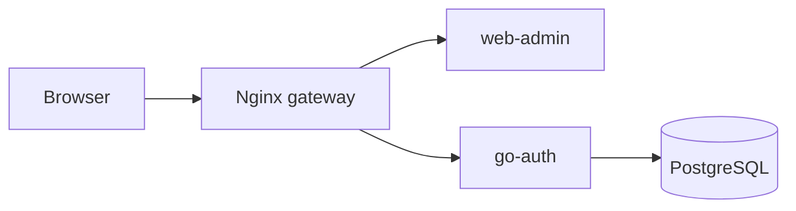

# Infrastructure

Runtime stack for an SMB technology product. Prioritize a sound technical core:
secure routing, correct configuration, persistent data, readiness, and recovery.
Deploy working backend contracts before product features. The admin UI is an
operating console for that core.



Provider callbacks also reach `go-auth` through the gateway. Redis is present
in Compose; the auth runtime can run with Redis disabled.

## Current layout

- `clusters/prod/gateway`: Nginx, upstreams, virtual hosts, static errors.
- `clusters/prod/go-auth`: auth, PostgreSQL 16 (shared instance with dedicated `auth` schema for low traffic), Redis 7, persistent volumes.
- `clusters/prod/go-product`: product catalog service, PostgreSQL 16 `go_product` database, persistent read model.
- `clusters/prod/web-admin`: static frontend.
- `clusters/prod/devops`: database administration tools.

These are Docker Compose manifests using an external `global` network. No GCP
deployment is defined here. The `prod` path is not evidence of a live release.

## Network architecture

The infrastructure strictly isolates traffic across two network tiers:

- **`global`**: Shared external-facing bridge network used for the gateway, frontend web apps (`web-admin`), and any external-facing BFF adapters where clients and browsers can route/call directly.
- **`internal`**: Private bridge network (`<service>_internal`) used exclusively for internal services, persistors, core shared backends, databases (`postgres`), and caches (`redis`). Databases and caches must only reside in the internal network and must never join `global`. The gateway bridges both tiers. `go-auth` joins only the named `go-auth_internal` network, which the gateway joins as an external network; start the auth stack before the gateway. This bridge permits outbound provider OAuth calls; it is not a Docker `internal: true` network.
  Images use local `latest` tags and startup ordering lacks health gates. The
  admin host uses local HTTP; its TLS listener is commented out. Complete the
  [delivery plan](../go-auth/specs/2026-10-17-smb-auth-core/02-delivery-phases.md)
  before treating the stack as production-ready.

## Routing and configuration

The admin host routes `/api/auth/v1/`, `/api/admin/v1/`, `/auth/callback`,
and Google provider callbacks directly to `go-auth`; `/` reaches the frontend.
The separate `web-admin-auth` container and upstream have been removed.
Enable and configure the [go-auth browser boundary](../go-auth/specs/2026-11-15-browser-auth-merge/browser-auth.md)
before switching an existing deployment. Gateway health does not prove application
or database readiness.

Use `go-auth/config/config.go` and embedded defaults as runtime truth. The infra
auth `.env.example` has been updated with `AUTH__PROVIDER_SECRET_KEY` and documents
the operator bootstrap CLI variables (`AUTH_BOOTSTRAP_CLIENT_SECRET`, `AUTH_BOOTSTRAP_AUTH_SECRET`).
Provider credentials belong in `clients` via `go-auth bootstrap-client` or the admin console.

Keep `.env`, private keys, cookie keys, and credentials outside the repo. Match
callbacks, approved redirects, issuer, origin, TLS, and cookie settings to the
identified target. Keep ops ports and databases private. Never print expanded
Compose config containing real secrets.

## Existing commands

Run from this repo on the intended Docker host after preflight. These commands
change runtime state:

```sh
make go-auth-up
make web-admin-up
make gateway-up
```

The Makefile invokes `docker-compose`. Confirm it exists or update targets to
the installed Compose CLI during delivery. `make gateway-test` runs `nginx -t`;
`make gateway-reload` reloads it. Validate routing before reload. Use
`docker compose -f <compose-file> config --no-interpolate --no-env-resolution -q`
for structural checks when supported; this does not prove runtime readiness.

## Release gates

The [core plan](../go-auth/specs/2026-10-17-smb-auth-core/00-overview.md) sets
historical backend, adapter, UI, and rollout gates. The adapter is now merged
into `go-auth`; build the auth and frontend app images,
pin release tags, identify target/schema, supply secrets, prepare backup/restore,
apply only the intended migration, and bootstrap the first client/admin before
routing live traffic. No migration runner or bootstrap is wired into Compose.

Check application readiness and end-to-end login/admin behavior. Keep previous
images, keys, and a compatible database rollback path. Never use `down -v` or
the initial down migration for release rollback. Agy coordinates phases; Claude
implements bounded changes. See the
[orchestrator handoff](../go-auth/specs/2026-10-17-smb-auth-core/03-agy-orchestrator.md).

## Browser auth consolidation

The deployment now consists of `web-admin`, the gateway, and `go-auth` with its
browser boundary enabled. Keep the existing database, registration UUIDs, JWT
signing keys, and provider encryption key. Supply a separate browser cookie key
and the registration's backend auth secret through protected server environment.
Do not put these values in `VITE_*` variables.

For an authorized rollout, build the changed images, configure browser auth,
and retain the approved product redirect `<browser-origin>/auth/callback` in the
registration. The provider redirect continues to target the go-auth provider
callback. Use the exact browser origin, including its port, and require HTTPS
and Secure cookies outside explicitly configured local development.

Start/recreate the auth stack before the gateway: the auth stack owns
`go-auth_internal`, which the gateway references externally. Preserve the Compose
project name and volumes. Recreate the gateway to attach that network. Once
login and admin access are verified, remove the old adapter container; removing
its service from YAML alone does not stop an already-running container.
Existing adapter cookies are not migrated; users may need to sign in again.

Rollback requires the previous auth/frontend images, gateway/Compose manifests,
and adapter image/config. Restore the old network attachments and adapter
routing together. No schema migration is required by this consolidation.
